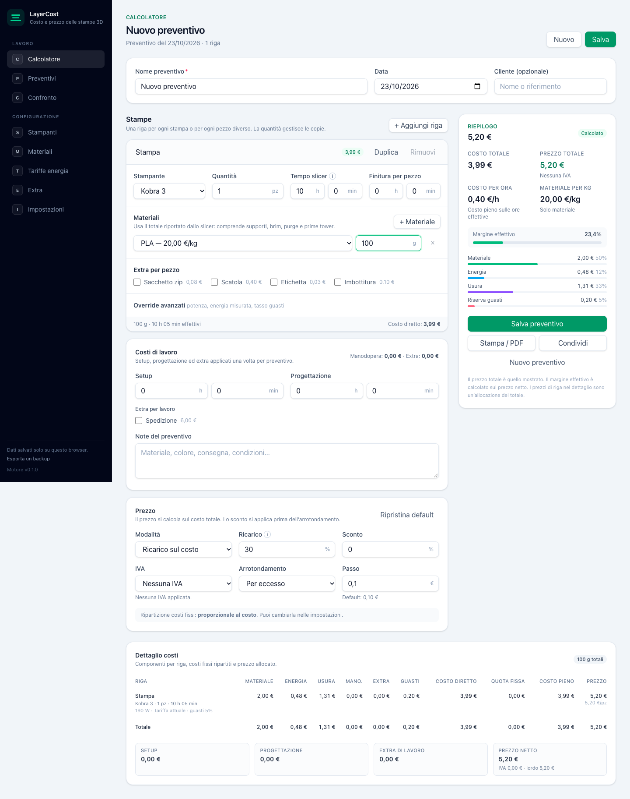

# LayerCost

[](https://github.com/doublelayerprints/layercost/actions/workflows/ci.yml)

**Live:** https://layercost.vercel.app

Calcolatore di costo e prezzo per stampe 3D, pensato per due stampanti reali: **Anycubic Kobra 3** (senza multicolore) e **Anycubic Kobra X** (con ACE 2 Pro). Tutti i parametri economici sono configurabili: tariffa elettrica, prezzi dei materiali, potenza media, vita utile, manutenzione, manodopera, tasso guasti, ricarico, IVA e arrotondamento.



## Cosa fa

- Calcola una stampa singola o un lotto, con più materiali per riga.
- Usa i grammi totali dello slicer: supporti, brim, purge e prime tower sono già inclusi.
- Stima energia dai W medi per famiglia di materiale, non dalla potenza nominale.
- Include usura: ammortamento `(prezzo − residuo) / ore di vita` + manutenzione €/h.
- Applica una riserva guasti con valore atteso `p/(1−p)`.
- Passa dal costo al prezzo con ricarico o margine, sconto, arrotondamento e IVA opzionale.
- Salva preventivi con snapshot dei prezzi usati; “Aggiorna prezzi” crea una copia.
- Confronta Kobra 3 e Kobra X sullo stesso lavoro.
- Importa un `.3mf` già slicato con anteprima dei piatti, mappatura di stampante e materiali e import nel preventivo.
- Esporta/importa JSON, condivide un preventivo via link, stampa il PDF dal browser.
- Tema chiaro, scuro o di sistema, con stampa sempre in nero su bianco.
- Funziona interamente nel browser: nessun backend, nessun account, nessun analytics.

## Stack

React 19 + TypeScript strict + Vite 8 + Tailwind CSS 4 + Zustand + Zod. Test: Vitest, fast-check, Playwright. Deploy: Vercel, con build statica portabile.

## Avvio

```bash
npm install
npm run dev
```

Apri `http://localhost:5173`.

## Comandi

```bash
npm run dev          # sviluppo
npm run build        # build di produzione
npm run preview      # anteprima build
npm run typecheck    # TypeScript
npm run lint         # oxlint
npm run test         # unit + dati
npm run test:e2e     # build + Playwright (Chromium + WebKit)
npm run test:visual  # regressione visiva (baseline Linux)
npm run budget       # budget del bundle
npm run check        # typecheck + lint + test + build + budget
```

## Dati e backup

I dati vivono in `localStorage` (`layercost:data`). Svuotare i dati del browser cancella anche i preventivi. La preferenza del tema è separata (`layercost:theme`) e non entra nei backup.

- **Esporta backup** da Impostazioni: file `layercost-backup-YYYY-MM-DD.json`.
- **Importa backup** sostituisce i dati, ma prima scarica automaticamente una copia di quelli correnti.
- I link condivisi contengono una copia del preventivo nell'URL: non sono un backup completo e non contengono la configurazione.

I valori di partenza di prezzi, potenze e vita utile sono **stime modificabili**. La guida iniziale porta a confermare i quattro numeri che contano: prezzo stampanti, vita utile, tariffa kWh, prezzi bobine.

## Deploy

**Live:** https://layercost.vercel.app

Repo GitHub: **https://github.com/doublelayerprints/layercost** (privata).

[](https://vercel.com/new/clone?repository-url=https://github.com/doublelayerprints/layercost)

Il progetto è una SPA statica con hash routing. Su Vercel:

- Framework preset: Vite
- Build: `npm run build`
- Output: `dist`
- Nessuna variabile d'ambiente obbligatoria

Sono possibili anche GitHub Pages, Netlify e Cloudflare Pages; vedi `docs/engineering/deployment.md`.

## Documentazione

| File                           | Contenuto                                        |
| ------------------------------ | ------------------------------------------------ |
| `STATUS.md`                    | Stato attuale, test, deploy e limiti             |
| `PLAN.md`                      | Visione, scope, architettura, roadmap            |
| `TASKS.md`                     | Task e stato di avanzamento                      |
| `AGENTS.md`                    | Regole per il coding agent                       |
| `docs/domain/cost-model.md`    | Specifica normativa del calcolo                  |
| `docs/domain/data-model.md`    | Schema e invarianti                              |
| `docs/domain/golden-cases.md`  | Esempi numerici e test                           |
| `docs/domain/sources.md`       | Fonti su stampanti e potenze                     |
| `docs/engineering/`            | Architettura, persistenza, test, release, deploy |
| `docs/planning/phase-5.md`     | Piano fase 5: `.3mf`, inglese, sync              |
| `docs/design/ui-brief.md`      | Requisiti per la fase design                     |
| `docs/design/directions.md`    | Direzioni e scelta visiva                        |
| `docs/design/design-system.md` | Token, componenti, accessibilità                 |
| `docs/adr/`                    | 19 decisioni architetturali                      |

## Stato

- **v1.0.0:** fasi 0–4 complete e rilasciate; tag `v1.0.0` su `cc949b3`.
- **Design:** direzione A — Strato, design system, redesign, stati e dark mode.
- **Verifiche:** 75 unitari, 26 E2E (Chromium + WebKit), 18 screenshot di regressione, axe 0 violazioni, stampa/PDF e budget.
- **Fuori v1:** sync cloud, magazzino bobine, PWA, inglese.
- **Fase 5:** import `.3mf` completo (T5.3) con fixture, parser ZIP/XML in worker, mapping, UI, performance e deploy; prossima interfaccia inglese (T5.6), sync gratuito rimandato. Piano in `docs/planning/phase-5.md`.
- **Repo GitHub:** https://github.com/doublelayerprints/layercost (privata).
- **CI:** verde su GitHub (`check` + `e2e`).
- **Deploy Vercel:** live su https://layercost.vercel.app, collegato alla repo.

La directory locale e il repository GitHub sono `layercost`; il nome del prodotto è **LayerCost**. Per lo stato aggiornato vedi `STATUS.md`.

## Licenza

Progetto personale. Licenza da definire.
